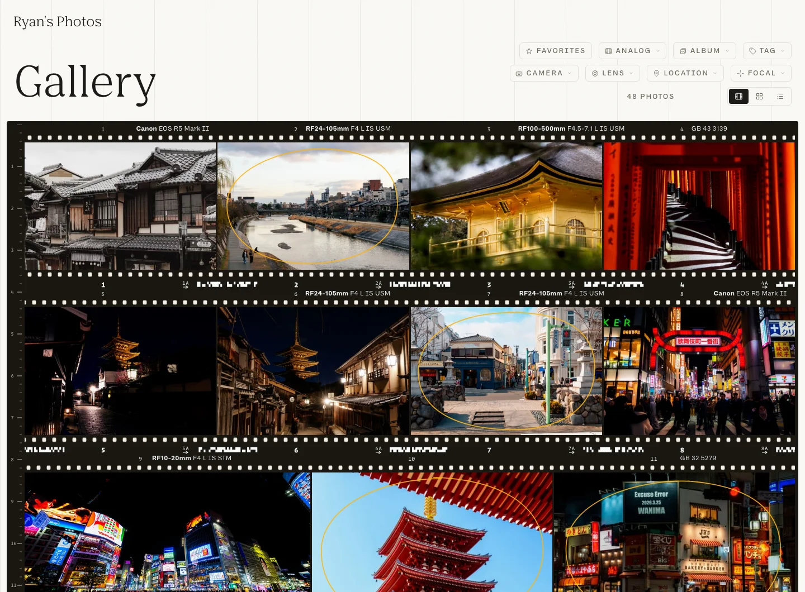
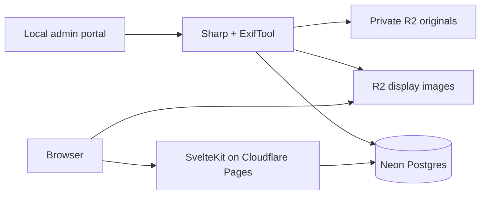

# Photo Album

A personal photography portfolio with an emphasis on composition, typography, and the details behind each photograph. Built with Svelte 5, SvelteKit, and TypeScript; served by Cloudflare Pages, Neon Postgres, and R2.

**[View the portfolio →](https://photos.ryansalik.com)**



## The experience

- **Three gallery views:** a justified grid, a film contact sheet, and a list with photographic metadata.
- **Postcard transitions:** photographs open with a title overlay, then settle into an uncropped view. Image loading progresses independently of the animation.
- **Connected metadata:** filter by album, location, camera, lens, exposure settings, tags, or film stock. Filter state lives in the URL and follows navigation between photographs.
- **Keyboard navigation:** open search with `⌘K` / `Ctrl+K`, move between photographs with the arrow keys, and skip the postcard sequence with `Space` or `Enter`.
- **A working publishing workflow:** local image processing, EXIF extraction, bulk uploads, album management, and configurable typography and presentation.
- **Shareable pages:** canonical photo URLs and dynamically rendered preview images for individual photographs and filtered galleries.

## Design and engineering

The application keeps expensive image preparation on a local machine and makes the public site a lightweight reader of prepared assets.



Four display sizes, a full-resolution JPEG, and an inline blur placeholder are generated at upload time. A stable image ID keeps cached assets independent of editable titles and slugs. Public image routes can redirect to the R2 custom domain, so image delivery does not require a database lookup.

Development uses embedded Postgres through PGlite and local image storage when cloud credentials are absent. The same query layer supports Neon in production. Analytics use daily aggregate counters; they do not store visitor identities or search text.

See [architecture](docs/architecture.md) for the code map and implementation tradeoffs.

## Run locally

Use **Node.js 24** and npm. ExifTool is recommended for complete photographic metadata; ImageMagick is only needed for the optional sample-data generator.

```sh
npm ci
cp .env.example .env
```

Set `ADMIN_PASSWORD` in `.env`, then start the development server:

```sh
npm run dev
```

Open [localhost:5173](http://localhost:5173). The gallery starts empty; upload photographs through `/admin`. Without `DATABASE_URL` or R2 credentials, all content stays under the ignored `data/` directory and no cloud account is required. A local session secret is generated automatically.

For generated sample photographs, install ExifTool and ImageMagick, keep the local server running, then use:

```sh
npm run seed
```

The seed command creates twelve synthetic images with sample metadata through the normal upload API. Use it with a local database; running the local server against Neon writes uploads to that database.

## Development commands

| Command           | Purpose                                       |
| ----------------- | --------------------------------------------- |
| `npm run dev`     | Start the local application and admin portal  |
| `npm run check`   | Check TypeScript and Svelte components        |
| `npm test`        | Run the automated regression tests            |
| `npm run format`  | Format source files and documentation         |
| `npm run build`   | Build the Cloudflare Pages application        |
| `npm run preview` | Preview the built application                 |
| `npm run seed`    | Generate and upload local sample images       |
| `npm run deploy`  | Check, test, build, and publish to production |

The [CI workflow](.github/workflows/ci.yml) runs the type check, the tests, and a production build on every push.

## Deploy

The site is a Cloudflare Pages project (SvelteKit's Cloudflare adapter, output in `.svelte-kit/cloudflare`) backed by a Neon database and two R2 buckets. Set the variables in [.env.example](.env.example) in Cloudflare's environment configuration, then run:

```sh
npx wrangler login   # once
npm run deploy       # check, test, build, wrangler pages deploy --branch master
```

Production is the `master` branch of the Pages project; a deploy from any other branch lands in the Preview environment, which has no database credentials.

Uploads run in the local admin portal because Sharp and ExifTool need native Node.js. The deployed admin manages existing photographs. Keep originals in a private bucket (`R2_ORIGINALS_BUCKET`) and serve only derived JPEGs from the public one.

### Maintenance scripts

These move data between local and cloud stores and are not part of a normal deploy. Load `.env` explicitly, for example `node --env-file=.env --import tsx scripts/pull-from-neon.ts`.

| Script           | Behavior                                                                 |
| ---------------- | ------------------------------------------------------------------------ |
| `migrate`        | Import a legacy SQLite catalog (`data/photos.db`) into PGlite or Neon.   |
| `push-to-neon`   | Copy missing local catalog records to Neon; existing rows are untouched. |
| `pull-from-neon` | Copy missing Neon records into local `data/pg`; Neon is not modified.    |
| `push-images`    | Upload missing local image files to R2.                                  |
| `normalize-gear` | Re-run camera-name normalization over stored photos.                     |

These are not a two-way sync, so back up the target before using them.
